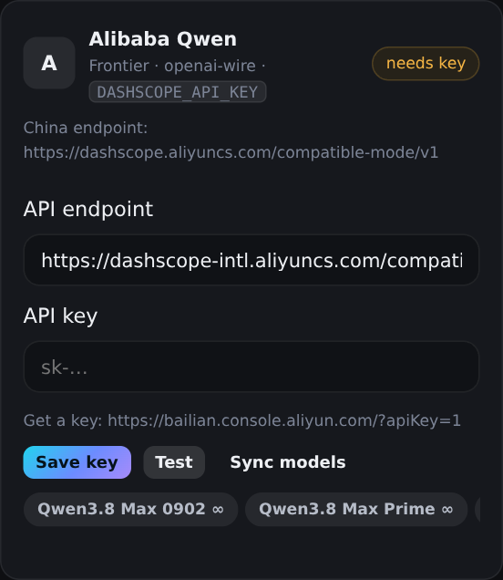
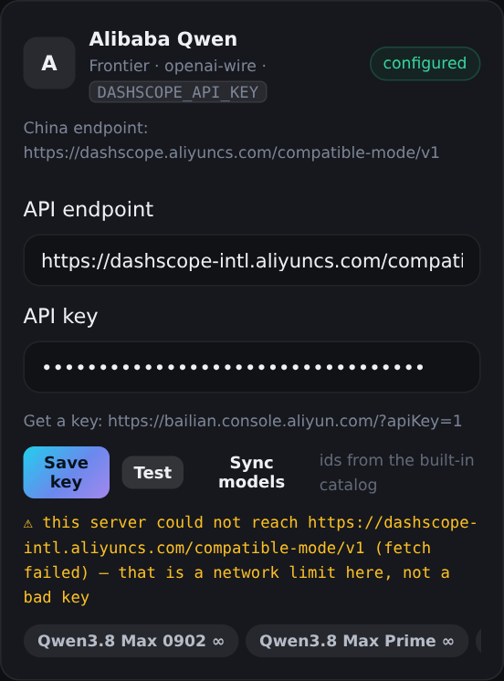
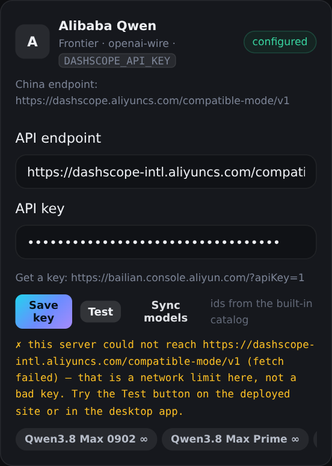
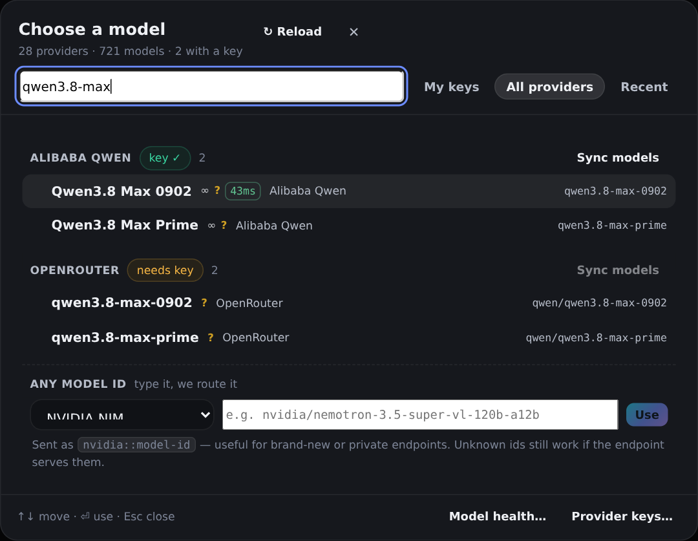
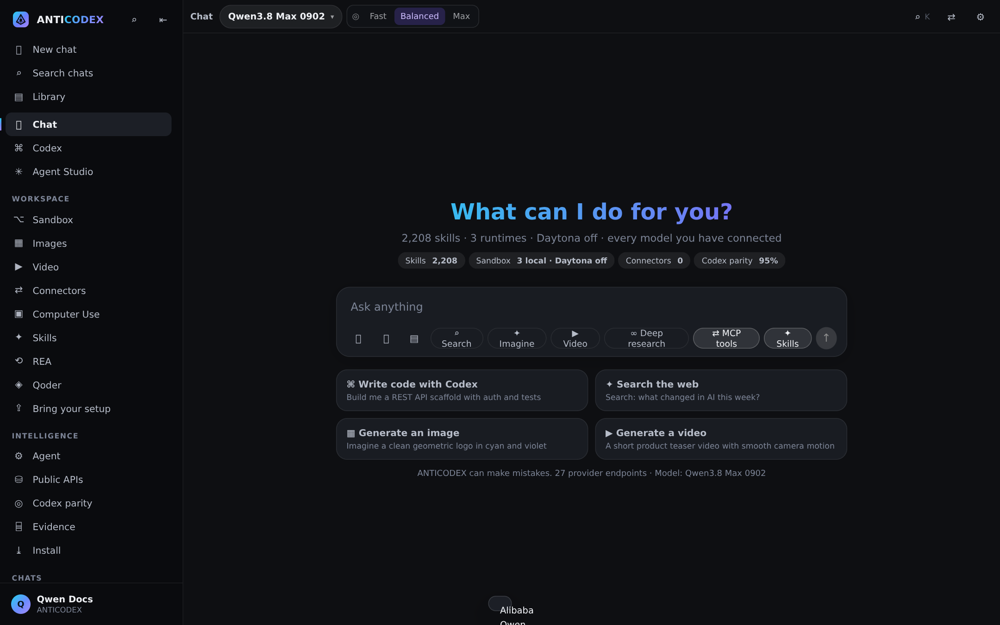
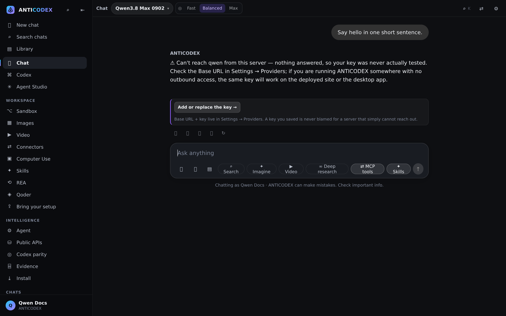

# Qwen in ANTICODEX

Recorded 2026-11-16. Every `[seen]` below is something I watched happen on this date;
every `[third-party]` number comes from a cited outside source; anything I could not
verify is marked as such and nothing here is invented. The placeholder key used in the
screenshots is not a real key and opens nothing.

**The one-line version:** ANTICODEX talks to Qwen two ways — the **Alibaba Model Studio**
OpenAI-compatible wire (provider id `qwen`, first-class endpoint shipped in the app) and
**OpenRouter** (`OPENROUTER_API_KEY`, ids prefixed `qwen/`). This page is how to get a
key, the exact ids, the five steps with screenshots, one real answer from inside the app,
and the things that broke on the way.

## Status of this page

| Section | State |
| --- | --- |
| How to get a key (both routes) | researched 2026-11-16, sources linked |
| Exact model ids (both wires + what the public docs show today) | [seen] in this repo's source |
| Five setup steps with screenshots | [seen] — screenshots are of a real local run |
| One real answer from Qwen inside the app | **pending your paste** — see §5. This sandbox cannot reach DashScope or OpenRouter and holds no key; the answer is deliberately not faked |
| Things that broke and how they were fixed | two fixed (one in this branch), one environment limit explained |

## 1. Getting a key

### Route A — Alibaba Cloud Model Studio (the wire the app ships first)

1. Create an Alibaba Cloud account and activate **Model Studio** (the service formerly
   sold under the DashScope name — the key env var is still `DASHSCOPE_API_KEY`).
2. Create an API key. The link this app prints in **Settings → Providers → Alibaba Qwen**
   is the Bailian console `https://bailian.console.aliyun.com/?apiKey=1`; the doc site
   prints `https://home.qwencloud.com/api-keys`; both land on the same console.
3. Put the key in ANTICODEX: **Settings → Providers → Alibaba Qwen → paste → Save key**.
   It is stored against your account (or mirrored into the desktop keychain on paired
   machines) and never logged.

**What "free" actually means today** (`[third-party]`, 2026-11-16):

- New accounts get **1 million input tokens and 1 million output tokens per eligible
  model** — not one shared pool per account — valid **90 days** from activation. Across
  the catalog that is roughly 70M free tokens in total. Singapore (International) is where
  the quota lives; Mainland China accounts get the equivalent in the **Beijing** region.
  The **Global/US Virginia** deployment has **no free quota**. The old indefinite free
  OAuth tier was discontinued on 2026-04-15, so tutorials promising standing free access
  are out of date.
- Sources: [Qwen API Pricing 2026 (lieke-ai, 2026-09-01)](https://lieke-ai.com/en/articles/qwen-api-pricing-2026.html) ·
  [Qwen API Pricing: Full Breakdown (Puter developer guide, 2026-09-01)](https://developer.puter.com/tutorials/qwen-api-pricing/) ·
  [Qwen3.5-Omni pricing & regions (wavespeed, 2026-04-02)](https://wavespeed.ai/blog/posts/qwen3-5-omni-api-pricing-2026/) ·
  official console [Model Studio](https://modelstudio.alibabacloud.com/) and [qwencloud.com/models](https://www.qwencloud.com/models/qwen3.8-max).

**Endpoints** (OpenAI-compatible, `…/chat/completions`):

| Deployment | Base URL | Free quota |
| --- | --- | --- |
| International (Singapore) | `https://dashscope-intl.aliyuncs.com/compatible-mode/v1` — what this build ships in `lib/catalog.js` | yes, 1M tokens/model |
| China (Beijing) | `https://dashscope.aliyuncs.com/compatible-mode/v1` — the note printed on the app's card | mainland accounts |
| Global (US Virginia) | `https://dashscope-us.aliyuncs.com/compatible-mode/v1` | none |
| QwenCloud quickstart (2026-08/11) | `https://ap-southeast-1.maas.qwencloudapi.com/compatible-mode/v1` — region-scoped alias printed by the official docs today | n/a |

The endpoint field in Settings is **editable**; if the alias your console shows differs
from the one this build ships, paste the console's one. Same service, same key.

### Route B — OpenRouter (one key, whole catalog)

1. Create a key at [openrouter.ai/settings/keys](https://openrouter.ai/settings/keys) (`sk-or-…`).
2. In ANTICODEX: **Settings → Providers → OpenRouter** → paste → Save key
   (`OPENROUTER_API_KEY`). The note on that card: *one key → the whole 470+ model
   catalog; the list auto-syncs live via `/api/v1/models`.*
3. Pick any `qwen/…` id from the model menu.

`[third-party]`: OpenRouter is pay-per-token and has **no standing free quota** for Qwen.
`:free`-tagged variants appear and disappear; check the model page before you rely on
one. Pick this route if you already hold an OpenRouter key or want Qwen metered next to
everything else on one bill. Pick Route A if you want the free Singapore quota.

## 2. The exact model ids

### A. Alibaba wire — what this build ships (`lib/catalog.js`, provider `qwen`, lines ≈174–185)

| Model id (sent as `model`) | Label in the app | Flags |
| --- | --- | --- |
| `qwen3.8-max-0902` | Qwen3.8 Max 0902 | `∞` reasoning |
| `qwen3.8-max-prime` | Qwen3.8 Max Prime | `∞` reasoning |
| `qwen3.8-flash` | Qwen3.8 Flash | — |
| `qwen3.8-omni-flash` | Qwen3.8 Omni Flash | vision |
| `qwen3.7-max` | Qwen3.7 Max | — |
| `qwen3.7-plus` | Qwen3.7 Plus | — |
| `qwen3.7-flash` | Qwen3.7 Flash | — |
| `qwen3.6-plus` | Qwen3.6 Plus | — |
| `qwen3.6-flash` | Qwen3.6 Flash | — |
| `qwen-plus` | Qwen Plus | — |
| `qwen3-coder` | Qwen3 Coder | — |
| `qwen3-coder-next` | Qwen3 Coder Next | — |
| `qwen3-coder-flash` | Qwen3 Coder Flash | — |

### B. OpenRouter wire — the `// qwen (43)` block (`lib/openrouter_models.js`, lines 44–56)

```
qwen/qwen-2.5-72b-instruct        qwen/qwen-2.5-7b-instruct
qwen/qwen-2.5-coder-32b-instruct  qwen/qwen-plus
qwen/qwen2.5-vl-72b-instruct      qwen/qwen3-14b
qwen/qwen3-235b-a22b-2507         qwen/qwen3-235b-a22b-thinking-2507
qwen/qwen3-30b-a3b                qwen/qwen3-30b-a3b-instruct-2507   qwen/qwen3-32b
qwen/qwen3-coder                  qwen/qwen3-coder-30b-a3b-instruct  qwen/qwen3-coder-flash  qwen/qwen3-coder-next
qwen/qwen3-next-80b-a3b-instruct  qwen/qwen3-next-80b-a3b-thinking
qwen/qwen3-vl-235b-a22b-instruct  qwen/qwen3-vl-30b-a3b-instruct     qwen/qwen3-vl-30b-a3b-thinking     qwen/qwen3-vl-8b-instruct
qwen/qwen3.5-122b-a10b            qwen/qwen3.5-27b                   qwen/qwen3.5-35b-a3b
qwen/qwen3.5-397b-a17b            qwen/qwen3.5-9b                    qwen/qwen3.5-flash-02-23
qwen/qwen3.5-plus-02-15           qwen/qwen3.5-plus-20260420         qwen/qwen3.6-27b
qwen/qwen3.6-35b-a3b              qwen/qwen3.6-flash                 qwen/qwen3.6-plus
qwen/qwen3.7-flash                qwen/qwen3.7-max                   qwen/qwen3.7-plus   qwen/qwen3.7-plus:batch
qwen/qwen3.8-2.4t-a95b            qwen/qwen3.8-27b                   qwen/qwen3.8-flash
qwen/qwen3.8-max-0902             qwen/qwen3.8-max-prime             qwen/qwen3.8-omni-flash
```

### C. What the public docs show today (`[seen]` on 2026-11-16, may drift)

The current QwenCloud page headlines **`qwen3.8-max`** — 2.4T-parameter MoE, 1M-token
context (991K max input, 131K max output, 983K/131K in thinking mode), $2.00 input /
$6.00 output per 1M tokens, implicit cache read $0.25/1M — plus `qwen3.8-flash`,
`qwen3.7-max`, `qwen3.7-plus`, `qwen3.7-flash` and `qwen3-vl-plus`
([qwencloud.com/models/qwen3.8-max](https://www.qwencloud.com/models/qwen3.8-max)).

This build instead catalogs the dated `qwen3.8-max-0902` / `qwen3.8-max-prime`. Dated ids
age: if the endpoint answers *"there is nothing like this model"*, press **Sync models**
(asks the endpoint for the ids your key can actually call), or type the exact id into the
picker's **Any model id** row, and ANTICODEX will route it. A rejected id is auto-hidden
from the picker for 12 h and re-tested (`lib/model-health.js`); Settings → Model health
can show it or put it back.

**Effort wiring** (the Fast / Balanced / Max dial in the topbar): Fast = 512 tokens,
temperature 0.3, no deliberation · Balanced (default) = 1200 tokens, 0.6,
`reasoning_effort: 'low'` · Max = 4096 tokens, 0.7, `reasoning_effort: 'high'`.
`reasoning_effort` is sent only where it is supported — the wires that document it
(`openrouter` is one), plus model families matching `qwen3|qwq|o\d|gpt-5|…` on any
OpenAI-compatible wire. If the wire answers 400/422 about the parameter, ANTICODEX retries
once without it and remembers for the process (`EFFORT_WIRES`, `REASONING_MODELS`,
`effortFor()`, `optionalParamRejected()` in `lib/providers.js`). Max is the right dial
for the `∞` Qwen3.8 reasoning models.

## 3. Five setup steps, with screenshots

All screenshots are a real local run of this exact tree at 1440×900 (`node server.mjs` +
`npm run build`), signed into a throwaway local account (`qwen.docs@example.com`,
`data/db.json`, gitignored). **The key typed in the screenshots is the placeholder
`sk-docs-placeholder-not-a-real-key`; it is not a key and opens nothing.** External
console pages cannot be screenshotted from this environment — step 1 is described, not
photographed.

**Step 1 — get the key.** Route A: Alibaba Cloud → Model Studio → create API key (§1).
Route B: openrouter.ai/settings/keys. Expected: a string starting `sk-…` (Alibaba) or
`sk-or-…` (OpenRouter). No screenshot — external site; the exact link is printed inside
the app's card as the "Get a key:" hint.

**Step 2 — open the provider card.** `http://localhost:8787` → **Settings → Providers →
Alibaba Qwen**. The card shows the category, the `openai` wire, `DASHSCOPE_API_KEY`, the
China endpoint note, and the model chips the catalog ships.



**Step 3 — paste the key → Save key.** Saving stores the key against your account and
then **immediately probes it** — the verdict line is colour-coded and is never a bare
"saved". Decoded: ✓ key accepted (and what it serves) · ⚠ could not reach the provider
(a network limit — not judged a bad key) · ✗ the provider rejected it (bad key/region).



In this sandbox the probe answered
`⚠ this server could not reach https://dashscope-intl.aliyuncs.com/compatible-mode/v1 (fetch failed) — that is a network limit here, not a bad key`,
which is the truth for an offline box (see §6.2). On any networked machine this step ends
in `✓ key accepted`.

**Step 4 — Sync models (optional, recommended).** Asks the endpoint which ids your key
can actually call; the card then says `ids confirmed by the endpoint` instead of
`ids from the built-in catalog`, and the picker marks each id ✓ (listed) or `?`
(unverified guess). The picker never hides a guess, only an explicit provider rejection.



**Step 5 — pick Qwen and talk.** Topbar → model picker → **All providers** tab → search
`qwen3.8-max` → click **Qwen3.8 Max 0902** (`Alibaba Qwen · qwen3.8-max-0902`; the same
id exists under `qwen/…` for OpenRouter, marked *needs key* until one is set). Set the
topbar dial to **Max** for the reasoning flagship, then ask.





When this server could not reach the provider, the answer was an explanation —
`⚠ Can't reach qwen from this server — nothing answered, so your key was never actually tested…`
with an "Add or replace the key →" callout — not a stack trace, and not a blamed key:



## 4. Screenshot index

| File | Shows | Taken |
| --- | --- | --- |
| `assets/qwen/01-provider-card.png` | step 2 | this run |
| `assets/qwen/02-save-key-verdict.png` | step 3 verdict | this run |
| `assets/qwen/03-sync-models-verdict.png` | step 4 verdict | this run |
| `assets/qwen/04-picker-broken.png` | the bug from §6.1, pre-fix | this run |
| `assets/qwen/04-model-picker-qwen.png` | step 5, picker | this run |
| `assets/qwen/05-qwen-selected.png` | step 5, model in topbar | this run |
| `assets/qwen/06-chat-with-placeholder-key.png` | the honest failure, §6.2 | this run |

`data/model-health.json` mid-session recorded `{ state: "network", latency_ms: 43–46 }`
for the unreachable probe — time-to-fetch-error, **not** a model answer; the file is
gitignored and was removed before finishing. The re-shot picker in `04-model-picker-qwen.png`
is from a fresh state with no health record.

## 5. One real answer from Qwen inside the app

**Pending your paste — deliberately not invented.** This environment has no route to
`dashscope*.aliyuncs.com` or `openrouter.ai` (every host outside GitHub/npm/PyPI is
blocked — §6.2) and no Qwen key, so the only honest options were "no answer" or "a fake
answer". You chose to run it and paste the answer back.

Produce it in about a minute on any networked machine:

```bash
git pull
cd web && npm install && npm run build && cd ..
npm start                       # → http://localhost:8787
```

Then steps 1–5 above with a **real** key (Route A or B), set **Max** on the dial, send:

> Explain idempotency in REST APIs in two sentences.

Paste back into this file (or into the chat and I will):

```text
Date / machine:            ________________________________
Route (A Alibaba / B OpenRouter): ________________________
Model id as shown in topbar:      ________________________
Prompt:                            Explain idempotency in REST APIs in two sentences.
Answer (verbatim):
__________________________________________________________
__________________________________________________________
First-token latency (topbar chip, if shown): ______________
```

The section heading stays "Pending your paste" until a real one lands here — that is the
whole point of the page.

## 6. Two things that broke, and how they were fixed

### 6.1 The "Choose a model" dialog opened off-screen — fixed in this branch

Opening the picker showed a dialog anchored to the **48 px top bar** instead of the
screen: header and search cut off above the viewport, the scrim 48 px tall, the list
floating with no way to click its own controls ([seen], `assets/qwen/04-picker-broken.png`).

Cause: `.topbar { position: sticky; backdrop-filter: blur(12px); }` (`web/src/styles.css`),
and a non-`none` `backdrop-filter` makes its element the **containing block for fixed
descendants**. The picker renders its `position: fixed` dialog inline inside the topbar,
so the dialog was laid out against the bar.

Fix: portal the dialog to `#root` (`web/src/ModelPicker.jsx`, `createPortal` — `#root`
is outside the topbar and inside this app's root node, and the jsdom mount test scopes
its queries to `#root`, so `document.body` was not an option). Rebuilt; the dialog now
centers on the screen with a full-viewport scrim and working controls
(`assets/qwen/04-model-picker-qwen.png`). `node tests/test-web-mount.mjs` →
**157 passed, 0 failed** (identical to the un-fixed base; the fix changes only the
subtree position).

### 6.2 The probe said "could not reach" — and that was the network, not the key

`curl https://dashscope-intl.aliyuncs.com` and `…openrouter.ai` → exit 000 from this
sandbox; only GitHub, npm and PyPI hosts answer. Every user-visible surface said so in
plain words instead of a stack trace ([seen]):

- **Save key →** `⚠ this server could not reach https://dashscope-intl.aliyuncs.com/compatible-mode/v1 (fetch failed) — that is a network limit here, not a bad key` (02)
- **Sync models →** `✗ … Try the Test button on the deployed site or in the desktop app.` (03)
- **Chat send →** `⚠ Can't reach qwen from this server — nothing answered, so your key was never actually tested. Check the Base URL in Settings → Providers…` plus an "Add or replace the key →" callout and the standing reminder that "A key you saved is never blamed for a server that simply cannot reach out." (06)

Fix: not a code change — an environment fact, answered by the app's existing honest
verdict paths. The same build, run anywhere with ordinary egress (your laptop, the
deployed site, the paired desktop app), ends step 3 in `✓ key accepted`. The rule this
page honors: no screenshot of a green checkmark nobody got.

### 6.3 Catalog ids vs dated docs — worth knowing before it bites

`[seen]` on 2026-11-16: this build ships `qwen3.8-max-0902` / `qwen3.8-max-prime`
against the Beijing/Singapore `dashscope*.aliyuncs.com` base URLs, while the official
pages headline `qwen3.8-max` and print a region-scoped
`ap-southeast-1.maas.qwencloudapi.com/compatible-mode/v1`. Both are "the same service";
the ids you can call depend on the deployment your key belongs to. If a call fails with
model-not-found: press **Sync models**, or edit the endpoint field in the same card, or
type any id into the picker's **Any model id** row (`provider::id` is sent verbatim — the
picker footer in 04 shows it). Genuinely rejected ids are hidden for 12 h and re-tested
(`lib/model-health.js`, Settings → Model health).

## 7. Appendix — reproduction and sources

Rebuild the screenshots:

```bash
cd web && npm install && npm run build && cd ..
node server.mjs &                 # 0.0.0.0:8787
# screenshots: puppeteer-core + @sparticuz/chromium; on a Linux box without
# libnss3, NSPR/NSS were built from source (codeload.github.com/mozilla/nspr
# NSPR_4_40_RTM, nss-dev/nss NSS_3_133_RTM) and LD_LIBRARY_PATH pointed at them.
```

Repo paths that own this behavior:

- `lib/catalog.js` — provider `qwen` (≈174–185), endpoint, `DASHSCOPE_API_KEY`, China-endpoint note, the 13 ids
- `lib/openrouter_models.js` — the `// qwen (43)` block (44–56), used as OpenRouter's static fallback list
- `web/src/pages/Settings.jsx` — the provider card, Save key → immediate probe, Sync models, `ids from the built-in catalog` vs `ids confirmed by the endpoint`
- `web/src/ModelPicker.jsx` — the picker (now portaled to `#root`), `All providers` tab, Any-model-id row
- `lib/model-health.js` — rejection hiding (12 h) and network-state recording
- `lib/providers.js` — `effortFor()`, `EFFORT_WIRES`, `REASONING_MODELS`, `optionalParamRejected()`, the OpenAI-compatible wire (one retry without `reasoning_effort`)
- `tests/test-web-mount.mjs` — the picker contract (modal lives under `#root`; 157 assertions)

Tests after the §6.1 fix: `node tests/test-web.mjs` (48/48) and
`node tests/test-web-mount.mjs` (157/157) pass.

Sources: [lieke-ai Qwen API pricing 2026](https://lieke-ai.com/en/articles/qwen-api-pricing-2026.html) ·
[Puter Qwen API pricing breakdown](https://developer.puter.com/tutorials/qwen-api-pricing/) ·
[wavespeed Qwen3.5-Omni pricing & regions](https://wavespeed.ai/blog/posts/qwen3-5-omni-api-pricing-2026/) ·
[QwenCloud Qwen3.8-Max page](https://www.qwencloud.com/models/qwen3.8-max) ·
[Model Studio (official)](https://modelstudio.alibabacloud.com/) ·
[Alibaba Cloud model catalog](https://www.alibabacloud.com/help/en/model-studio/models) ·
[OpenRouter keys](https://openrouter.ai/settings/keys). Free-quota numbers are marked
`[third-party]` because Alibaba does not publish one canonical free-tier page; the two
September 2026 sources above agree on 1M tokens/model/90 days (Singapore) and differ on
mainland minutiae.
